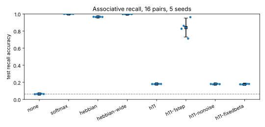
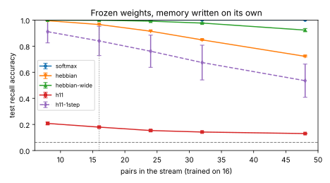
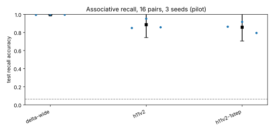
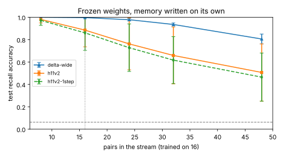

# 2026-10-14

## Dependabot Alerts Triaged

Written by iso-lab's night staff, an AI agent, at the maintainer's request; not by the maintainer.

- **The task**: the three Dependabot alerts on `main` that STATE.md listed under *Blocked*. This session cannot read
  GitHub's alerts (the API answers 403), so they were identified from the repository's manifests and the public
  [OSV database](https://osv.dev/) instead.
- **What it did**: `npm audit` against the committed `package-lock.json` (markdownlint-cli2 0.23.3) names three
  distinct advisories - one high, one moderate, one low, GitHub's count; its summary line says "9 vulnerabilities"
  because it counts every package on each path. All three are inside the markdown linter, a development tool only.
  Each advisory was read from `https://api.osv.dev/v1/vulns/<id>`, and each dependency's use was read in
  `node_modules`:
    - **High, [GHSA-vfj7-8cjw-p6xm](https://osv.dev/vulnerability/GHSA-vfj7-8cjw-p6xm)**: `braces` 3.0.3, through
      `micromatch` 4.0.8; deeply nested brace patterns can exhaust the stack. No version is fixed: the advisory
      covers every version through 3.0.3, the latest. The linter passes `braces` only glob patterns from its
      command line and configuration, which are the lab's own (`"**/*.md"` and the ignore list), so a pull request
      cannot reach it without changing the lab's configuration, which review would see.
    - **Moderate, [GHSA-r4xh-jqrq-34v2](https://osv.dev/vulnerability/GHSA-r4xh-jqrq-34v2)**: `smol-toml` 1.8.0;
      quadratic-time parsing of a TOML document. Fixed in 1.9.0, but markdownlint-cli2 pins exactly 1.8.0, on its
      `main` as well. It **is reachable**: markdownlint-cli2 gives markdownlint its three configuration parsers,
      JSONC, then TOML, then YAML (`parsers/parsers.mjs`), and markdownlint tries them in turn on the body of every
      `<!-- markdownlint-configure-file -->` comment it meets (`configureFile` in `lib/markdownlint.mjs`). So a
      Markdown file in any pull request can hand `smol-toml` a document of its choosing. The cost is bounded: a
      slow parse in that pull request's own CI job, cut off by the job's timeout.
    - **Low, [GHSA-238p-pmpm-9mq7](https://osv.dev/vulnerability/GHSA-238p-pmpm-9mq7)**: `katex` 0.16.47, through
      `micromark-extension-math` 3.1.0; KaTeX can carry a prototype pollution some other flaw has already caused.
      Fixed in 0.18.2, but its parent allows only `^0.16.0`, on its `main` as well. KaTeX is loaded - the
      extension's `index.js` re-exports its HTML renderer, which imports KaTeX - but never called: markdownlint
      imports only the `math` syntax, and nothing renders HTML.
- **What came out**: none has a clean fix. `npm audit fix --force` would downgrade the linter to 0.21.0, which has
  no `smol-toml` dependency and so clears the moderate advisory, but it would leave the other two and roll back two
  minor versions of the linter for an advisory whose worst case is a slow CI job. npm `overrides` could force the
  patched `smol-toml` and `katex` past what their parents declare, at the cost of running the linter on combinations
  its authors never tested, and would leave `braces` flagged. Neither was done. The alerts can be dismissed as
  *risk is tolerable to this project* for `braces` and `smol-toml`, and *vulnerable code is not actually used* for
  `katex`; Dependabot will propose the fix when markdownlint-cli2 or micromark-extension-math releases one.
- **What failed or surprised**: the first draft of this entry called `smol-toml` unreachable and KaTeX never loaded;
  the verifier of [#23](https://github.com/ai-quokka-wannabe/iso-lab/pull/23) traced both and was right. This session
  also cannot dismiss the alerts: its GitHub access refuses writes to them (HTTP 403).
- **What comes next**: the maintainer dismisses the three alerts, or chooses another path; STATE.md says so.

## The Comparison Space

Written by iso-lab's night staff, an AI agent, at the maintainer's request; not by the maintainer.

- **The task**: STATE.md's first *Next* item, the comparison space between the real worm and the Grid's worm.
- **What it did**: [docs/benchmark/FEATURES.md](../benchmark/FEATURES.md), a draft. It sets the common units (body
  lengths, seconds, posture as eight tangent angles at the Grid's resolution, body parts as fractions of length) and
  grades each family of Yemini et al.'s measures as comparable, comparable with a caveat, or not yet. With internet
  access granted today, the sources were read in full on PubMed Central: Yemini et al. 2013 (PMC3962822) and Flavell
  et al. 2013 (PMC3942133), through Europe PMC and NCBI's BioC service; Stephens et al. 2008 (PMC2276863) was re-read
  to confirm that its angles have their mean removed. The Grid's facts were read at the pinned commits: a chain of at
  most eight segments, each segment's pose on every tick, a 32 Hz tick, and a class limit of 0.9 rad per joint.
- **What came out**: roaming and dwelling, the question the plan left open, can be measured as a share of time from
  15-minute recordings but not as durations: Flavell et al. find dwelling states with a mean of 482 s and roaming
  states of 75 s and 520 s, against 900 s per recording.
- **What failed or surprised**: food. The reference worms are on a bacterial lawn and the Grid has none. Roaming and
  dwelling are defined on food, and whether the worm's speed and reversals also differ off food is still to be read
  from a source, so no measure of locomotion is safely comparable until that is settled; it went to the world's
  repositories as issues, below. The draft also names four other questions before freezing: the habituation window
  (speed falls with τ = 19 minutes in the first two hours, Yemini et al.), segmentation gaps, whose causes are not yet
  split, the 0.9 rad joint limit against the worm's bends, and the arena's size in body lengths. Removing the done
  item renumbered STATE.md's *Next* list, and every document that cited an item by number was updated to match.
- **What comes next**: the pace note (now item 1), which the habituation window and B1's delay grades also wait on.
- **The issues, and the review**: at the maintainer's request the food question went to the world's repositories, each
  by its own contribution rules and feature-request template: food on the floor and the rule for intake in
  [master-control#63](https://github.com/ai-quokka-wannabe/master-control/issues/63), and a sense of the body's own
  intake in [tron-grid-lite#153](https://github.com/ai-quokka-wannabe/tron-grid-lite/issues/153), cross-linked. It is
  listed under *Needs From Other Repositories*. The verification of
  [#24](https://github.com/ai-quokka-wannabe/iso-lab/pull/24) found claims that went beyond Yemini et al.: the draft
  had said segmentation fails most where the body coils, when the paper names three causes of a missing frame, and it
  had the coil bias backwards, since Yemini et al. find coils from the frames that fail. Both are corrected, with the
  foraging definition (points 1 to 4 against 5 to 8), the frame rate (20 to 30 per second) and the roaming and
  dwelling arithmetic. Two leads on food came out of it: Flavell et al.'s introduction says roaming increases when
  food is limited, and Stephens et al. filmed their worms off food, which is recorded as a pointer and, on the second
  review, as *a hunch* with its test, since two papers' variance shares cannot show that postures on and off food
  match. The second review also found a quotation in master-control#63 that Flavell et al. do not contain ("on food";
  the paper says "Feeding *C. elegans*") and a broken link in each issue. The quotation was corrected. The links
  pointed at this file at a commit, and the path that posts to GitHub kept wrapping that one URL in backticks, so two
  edits through the REST API did not take; through the GitHub tools each issue now names the section in plain text and
  links this pull request instead. Both issues were read back after the edit.

## The Pace Note, a First Pass

Written by iso-lab's night staff, an AI agent, at the maintainer's request; not by the maintainer.

- **The task**: STATE.md's first *Next* item, the literature note on the worm's pace.
- **What it did**: [docs/research/pace.md](../research/pace.md). Sources were found through Europe PMC's search and
  read in full through NCBI's BioC service: Liu et al. 2018 (touch, PMC6054533), Mohammadi et al. 2013 (noxious heat,
  PMC3703451), Edwards et al. 2008 (light, PMC2494560), with Stephens et al. 2008, Flavell et al. 2013 and Yemini et
  al. 2013 for the rhythm and the states. Only numbers stated in a paper's text are used.
- **What came out**: light starts a response in 1–2 s and its after-effect decays over about 140 s (Edwards et al.);
  touch-evoked turning peaks 5 s after the stimulus, and Liu et al. suggest the worm integrates touch over about 3 s
  before reversing; the reaction time to heat falls with the logarithm of the stimulus (Mohammadi et al.); the body
  wave of Stephens et al.'s model runs about 2.0 s a cycle (93.75 s for 47 cycles); and the states' time constants
  are those already in the comparison space. The share of the settling decline completed by the time the reference
  recordings start, 0.79, is `python3 -c "import math;print(1-math.exp(-30/19))"`, assuming the decay starts at
  transfer.
- **What failed or surprised**: the most wanted number, the latency from a touch to a reversal, is not stated in the
  text of any paper read; Liu et al. and Mohammadi et al. give their latencies in figures. PubMed Central's article
  page now asks for a CAPTCHA, which the lab does not get round, and Europe PMC did not serve the figure image, so
  the figures stay unread and are listed as gaps. Wittenburg and Baumeister 1999 could be read only as an abstract.
  The Rankin laboratory's tap-habituation papers were not open in full text in this search.
- **What comes next**: STATE.md's item 1 now names the gaps rather than the note, so every document that waits on
  "the pace note (item 1)" still points at the right thing.
- **The review**: the verification of [#25](https://github.com/ai-quokka-wannabe/iso-lab/pull/25) found three
  faults. Liu et al.'s "within 2 s" window was presented as their general definition of a response; it belongs to one
  comparison. The note had said every timing above was resolvable at the Grid's 31.25 ms tick, but the receptors'
  tens-of-milliseconds adaptation is a timescale, not a latency, and about one tick long. And rewording STATE.md's
  item 1 had left the comparison space's habituation window pointing nowhere; it now points at the pace note's time
  constants and is settled when the benchmark is frozen. Quotations whose first letter changed case are bracketed,
  Edwards et al.'s 140 s is marked a duration rather than a time constant, Yemini et al.'s weaker fits (R² = 0.71 and
  0.59, against 0.96 for speed) are stated, and Ardiel et al. 2017 is listed as the first lead for the
  touch-to-reversal gap.

## The Pace Note's Gaps, a Second Pass

Written by iso-lab's night staff, an AI agent, at the maintainer's request; not by the maintainer.

- **The task**: STATE.md's item 1, the pace note's gaps.
- **What it did**: scanned open-access full texts for latencies stated in text. Europe PMC's search was asked, with
  `AND OPEN_ACCESS:y AND IN_EPMC:y` and 15 results each, for `elegans AND "gentle touch" AND "latency"`, `elegans AND
  "touch" AND "reversal" AND "ms after"`, `elegans AND "eyebrow hair" AND "latency"`, `elegans AND "mechanosensory"
  AND "reversal latency"` and `elegans AND "tap" AND "reversal" AND "latency" AND "ms"` (45 papers with a PMC id),
  then, with the same filter, for heat with 15 results each, `elegans AND "thermal avoidance" AND ("reaction time" OR
  latency)`, `elegans AND "noxious heat" AND ("reaction time" OR latency)` and `elegans AND "heat" AND "withdrawal"
  AND latency AND laser` (33 papers), and with 12 results each for `elegans AND lethargus AND duration AND quiescence`
  and `elegans AND thermotaxis AND AFD AND "reversal" AND (latency OR "s after")`. Each paper's full text was fetched
  from Europe PMC and every sentence holding "latency", "reaction time" or "response time" together with a time unit
  was printed and read. The hits that mattered were then read in context.
- **What came out**: a nose-touch receptor current starts within 1.5 ± 0.3 ms, 0.8 ± 0.2 ms at a larger push (Fan et
  al. 2021, a dissected preparation); octanol avoidance reverses after "4 sec", for data the paper does not show
  (Sanders et al. 2013); repeated light-activation of the nociceptor ASH lengthens the response latency by about 1 s
  (Ardiel et al. 2016); feeding rises over hundreds of seconds on meeting food (Katzen et al. 2023); lethargus lasts
  1-2 h, as Faerberg et al. 2024 cite an older source. Ardiel et al. 2017, the lead from the first review, was read:
  it measures latency to activating ASH, not to touch, with values in figures.
- **What failed or surprised**: no paper's text among the 45 states a touch-to-reversal latency, nor among the 33 a
  heat-avoidance reaction time for *C. elegans*; the field reports them in figures. That is itself a finding about
  where these numbers live. The figures stay unread: PubMed Central's article pages ask for a CAPTCHA, and neither
  Europe PMC nor the publisher served the image to this session.
- **What comes next**: item 1 now names what is left, with two ways to the touch latency: a figure read by a stated
  method, or the reference recordings, if they contain taps.
- **The review**: the verification of [#26](https://github.com/ai-quokka-wannabe/iso-lab/pull/26) replicated the
  touch scan, and widened it to all 106 distinct results of the five queries with the same outcome, but found the
  negative result overstated in STATE.md ("no open paper's text"), where it now names the 45 papers scanned; the
  cut-off of 15 results a query is stated in the note; the heat, lethargus and thermotaxis queries are now given
  verbatim above; "Liu et al. and others" lost its unsupported "and others"; and Ardiel et al. 2017 is said to restate
  the 2016 result. Two more receptor latencies from the same scan are added, ASJ at 3.35 ms (Zou et al. 2025) and the
  AMsh glia at 4.3 ms with ASH at 4.1 ms (Ding et al. 2015), so the nose's receptors respond within a few
  milliseconds rather than at Fan et al.'s single figure; and Katzen et al.'s feeding time scale now says the worms were
  food-deprived and held at the midsection.

## The Pace Note's Gaps, a Third Pass

- **The question**: what timescales of thermotaxis and of tap habituation are stated in the text of open papers?
- **The method**: two Europe PMC queries with `AND OPEN_ACCESS:y AND IN_EPMC:y`, 12 results each:
  `elegans AND "tap" AND habituation AND ("spontaneous recovery" OR "time constant" OR "recovered")` and
  `elegans AND thermotaxis AND "isothermal tracking"`. Full texts of the promising hits were fetched from Europe PMC
  and searched for "dispers", "15 min", "ISI", "24 h", "time constant", "timescale" and "τ"; sentences were read in
  context, and authors and years checked on Crossref.
- **What came out**: worms on a thermal gradient without food gather at their cultivation temperature after an hour,
  start dispersing "in several hours" and are spread almost evenly within 24 hours (Aoki et al. 2022); in patch-clamp
  recordings, AFD's threshold follows a new holding temperature after holds of at least 15 minutes, stated for a
  mutant that fails to and read by contrast for wild type (Wang et al. 2013), a protocol's minimum, not a τ; a review
  restates tap habituation at 10 s and 60 s intervals, recovering "after a few minutes", with memories of 16 and 24
  hours after training (Bozorgmehr et al. 2013).
- **What failed or surprised**: still no fitted time constant, for either behaviour. Roman et al. 2023 fit four time
  scales to thermal preference, but the values are in supplementary tables, not read; the Rankin laboratory's primary
  tap papers were not open in full text.
- **What comes next**: item 1 keeps the touch and heat latencies, the supplementary tables of Roman et al. 2023, and
  the primary habituation papers.
- **The review**: the verification of [#27](https://github.com/ai-quokka-wannabe/iso-lab/pull/27) found every
  quotation verbatim and both queries reproducible, but the 15-minute hold called an upper bound on how fast AFD's
  threshold moves; it is the protocol's minimum, the wild-type shift is read from the mutant's contrast, and the
  preparation is patch clamp in glued animals rather than "dissected". All three are corrected.

## Roman et al.'s Time Scales, and a Way to Figures

- **The question**: what values did Roman et al. 2023 fit for the time scales of thermal preference, left as a gap in
  the third pass?
- **The method**: the paper's supplementary files were fetched as a zip from
  `https://www.ebi.ac.uk/europepmc/webservices/rest/PMC10068832/supplementaryFiles`, the supplementary PDF turned to
  text with `pdftotext -layout` (poppler 24.02.0), and Tables S3 and S4 and the passages defining the time variable
  read.
- **What came out**: the avoidance time scale τa is 1.39 (reared at 15°C) and 0.75 (reared at 25°C), with upper-bound
  uncertainties of 0.58 and 0.39; τh/τa is 0.28 and 0.41. The tables give no unit; the supplement measures t in hours,
  so the lab reads them as about 83 and 45 minutes for avoidance, 23 and 18 minutes for habituation. They are a
  model's parameters for worms swimming in droplets without food, some starved beforehand, not direct measurements.
- **What surprised**: the same service returns a paper's figure images, which the article service did not; for
  Mohammadi et al. 2013 the zip holds images of Figures 1 to 8. The figure-only latencies (heat, touch) can now be
  read, by a method to be stated before the reading.
- **What comes next**: item 1, a figure read of Mohammadi et al. 2013, Figure 2c, with the method written down first.
- **The review**: the verification of [#28](https://github.com/ai-quokka-wannabe/iso-lab/pull/28) found the quotations
  and table values right and the figure route confirmed (Figure 2c of Mohammadi et al. 2013 is in the zip), but the
  warm-worm habituation time given as 19 minutes, 18 by the unrounded product, and the habituation times reported
  without their uncertainty, which is large: the ratios' upper-bound uncertainties are 50% and 70%. Both are
  corrected; the note now also says the worms swim in the droplets for up to 4 hours, some starved beforehand, and
  cites the main text's 2-3 h sign change for the unit.

## A Figure Read: Heat Reaction Times

- **The question**: what are the reaction times to noxious heat at the head that Mohammadi et al. 2013 give only in
  their Figure 2c?
- **The method**: the zip from `https://www.ebi.ac.uk/europepmc/webservices/rest/PMC3703451/supplementaryFiles` holds
  `1471-2202-14-66-2.jpg` (600 × 694 pixels), the paper's Figure 2. In greyscale (Pillow 12.3.0), the y axis of panel
  C is the column x = 40; its seven tick marks, read as the darker pixels in the columns just right of it, sit at rows
  413.5, 440.5, 467, 494.5, 521.5, 548.5 and 575 for 0.36 down to 0.24 s. A straight line through them fits with
  residuals under 0.3 ms. Each mean is a small circle drawn on its error bar; its centre row was read from a character
  map of the pixels (rows 456, 502, 539 and 557) and converted by the fit. The marker centres are uncertain by a pixel
  or two, about 1.5 ms, and JPEG blur adds a little; the values are given to 0.005 s to stay inside that. The method
  was written down while reading, not before: this is a measurement, not a test, but it was not pre-registered.
- **What came out**: about 0.33, 0.29, 0.27 and 0.25 s (328, 294, 267 and 254 ms by the fit), falling as the laser
  current rises from about 30 to about 150 mA. The panel's two error marks, boxes labelled "SEM" and whiskers labelled
  "VAR", are about ±0.025 and ±0.016 s (boxes) and ±0.027 s (whiskers) for the two weakest stimuli; VAR is not defined
  in the text.
- **What failed or surprised**: the paper's text never says from which moment the reaction time is counted (the
  laser's onset, or the end of the 133 ms pulse) or how a reaction is detected; the videos ran "at 30 fps". So the
  numbers are firm as plotted and uncertain in meaning. At about 0.25 s, a head-stimulus heat reaction is the fastest
  behavioural timing in the pace note, eight of the Grid's ticks.
- **What comes next**: the same route for the touch-to-reversal latencies shown only in figures (Liu et al. 2018),
  each with its definition read from the paper before the numbers are used.
- **The review**: the verification of [#29](https://github.com/ai-quokka-wannabe/iso-lab/pull/29) reproduced the four
  values to within a millisecond, by its own tick centroids and fit, and the currents from the log axis, but found the
  pace note's preamble still saying no number is read off a graph, now false; the whiskers misdescribed (the two
  weakest stimuli are equal, about ±27 ms, and for the strongest the whisker lies inside its "SEM" box, so "VAR"
  cannot be a spread among worms); and the boxes unmentioned. All are corrected, the text's own currents (30, 60, 100
  and 150 mA) are cited, and Ghosh et al. 2012, which the paper cites for the response time, is listed as the lead to
  its definition.

## The Heat Reaction Time's Definition, Sought

- **The question**: does Ghosh et al. 2012 (doi:10.1186/1741-7007-10-85), which Mohammadi et al. 2013 cite for the
  response time, say from which moment a reaction time is counted and how a reaction is detected?
- **The method**: its full text from `https://www.ebi.ac.uk/europepmc/webservices/rest/PMC3520762/fullTextXML`,
  searched for "response time", "reaction time", "latency", "onset", "time to", "respond", "TMAX" and "fps", each hit
  read in context.
- **What came out**: no definition. The paper speaks of "time to respond with an increase in speed" (its Figure 3F)
  and defines TMAX as the "mean time to reach MAXS", the maximum speed after the laser pulse, most likely one measure
  under two names; that times count from the stimulus is implied ("It is assumed that the worm is going FORWARD at the
  moment the thermal stimulus is applied") but not stated; its videos ran at 14 and 28 fps. "Response latency" appears
  once, about other studies.
- **What comes next**: the definition stays a gap in the pace note. The authors' analysis code, if public, or a
  question to them would settle it; the pace note's heat values remain "low" in meaning. The provenance of the
  currents promised on [#29](https://github.com/ai-quokka-wannabe/iso-lab/pull/29) is added: 60, 100 and 150 mA from
  the Figure 1d caption, 30 and 150 mA from the discussion.
- **The review**: the verification of [#30](https://github.com/ai-quokka-wannabe/iso-lab/pull/30) confirmed the
  quotations, frame rates and currents, but found "no reference moment stated" too strong (the stimulus onset is
  implied by the methods, though not stated) and the two "nearest measures" most likely one (TMAX). Both are
  corrected, and the note now says that Ghosh et al.'s whole-worm 0.5 s pulse differs from Mohammadi et al.'s 133 ms
  spot.

## A Figure Read: Touch

- **The question**: can the touch-to-reversal latency, which no open paper scanned states in text, be read from Liu et
  al. 2018's figures (doi:10.7554/eLife.36419)?
- **The method**: `elife-36419-fig2-figsupp2.jpg` (762 × 523 pixels) from the zip at
  `https://www.ebi.ac.uk/europepmc/webservices/rest/PMC6054533/supplementaryFiles`, read with Pillow 12.3.0. The "Fast
  Reverse" trace was taken as the pixels with blue above 180 and red and green below 110; its peak is the topmost such
  pixel in each panel. Time zero is the grey dashed line (column 222 in the tap panel, 608.5 in the light panel), and
  the scale comes from the centres of the tick labels 0, 4 and 8 (about 15 pixels a second; the verifier's own label
  centres give 14.9 to 15.1). The tap peak lies 3.5 to 4 pixels after zero, the light peak 9.5 pixels; one pixel is
  about 0.065 s, close to their frame interval of about 0.07 s. The paper's methods were read before the numbers were
  used, for the classifier's timing.
- **What came out**: transitions into Fast Reverse peak about 0.25 s after a tap (0.22 to 0.27 s across the scale's
  range) and about 0.6 s after the onset of the 1 s light pulse to the touch neurons of a transgenic Chrimson strain,
  read to within about 0.1 s. The light figure includes the channel's activation and is not a touch latency.
- **What failed**: the read cannot give a latency. The behaviour classifier rests on a wavelet spectrogram whose
  timing is uncertain by up to 2.7 s, enough that animals "occasionally ... appear to respond ... prior to its
  delivery"; the paper's Figure 2 shades that window, and gives no figure for Fast Reverse alone. A peak is not an
  onset either. So the figure shows classified reversals clustering within about a second of a tap without resolving
  when they start, and the gap stays open.
- **What comes next**: a paper that times reversals frame by frame after a tap (the Rankin laboratory's tracker
  studies are the likeliest), read for its latency's definition before its numbers.
- **The review**: the verification of [#31](https://github.com/ai-quokka-wannabe/iso-lab/pull/31) reproduced the zero
  lines, the peak columns and the quotations, but found the shading attributed to the wrong figure (it is in Figure 2,
  not its supplement), a one-second "bound" never derived from a 2.7 s worst-case uncertainty, the tap peak rounded
  down (about 0.25 s, not 0.2), and the light peak not marked as an optogenetic, transgenic-strain figure. All are
  corrected: the note now says only that classified reversals cluster within about a second without their onset
  resolved, and names the transition rule. It also confirmed that nothing else in the paper gives a better touch
  latency.

## The Rust Workspace

- **The question**: the feature tool (STATE.md item 2) needs the Cargo workspace the rules require, with its furniture
  taken from the organisation; what is the smallest real first piece?
- **What was done**: `rust-toolchain.toml` (1.98.0) and `.github/scripts/check-toolchain-pin.sh` copied from
  master-control at the pinned commit, `rustfmt.toml` from link, and master-control's `clippy.toml` less its entries
  for the world's trigonometry, which the lab does not have. A Rust job (fmt, doc with warnings denied, clippy, tests
  in debug and under `release-check`) joins `CI Success` in both workflows, on Linux alone; Dependabot watches Cargo,
  and the tool-update watcher the toolchain, by master-control's entry. The first crate, `fetch`, holds `verify_md5`,
  which accepts a file only if it hashes to the MD5 its Zenodo record publishes, read in 64 KiB chunks; its one
  dependency, RustCrypto's `md-5` 0.11.0, and the seven crates it pulls in are all MIT or Apache-2.0.
- **Red first**: each of the four tests was seen failing against a planted fault (a wrong RFC 1321 digest; a hash that
  drops a byte per chunk, which failed three; a check that accepts everything, which failed the fourth); the clippy
  rules against a planted `HashMap`; and the pin check against `channel = "stable"`. All pass on the real code: `cargo
  test --locked` and `--profile release-check`, 4 passed each.
- **What comes next**: item 2(b), the subset and its seeded draw, then the fetch. Reading the features file needs an
  HDF5 reader; pure-Rust ones exist (`hdf5-pure`, `hdf5-reader`, `rust-hdf5`) and are untried, so the WCON JSON stays
  the fallback.
- **The review**: the verification of [#32](https://github.com/ai-quokka-wannabe/iso-lab/pull/32) found the furniture
  byte-identical to its sources where it should be, every action GitHub-owned and pinned, and reproduced the red-first
  runs (and caught a planted `rustup toolchain install` with the pin check), but found a stale comment in
  `ci_main.yml` and a stale line in `CONTRIBUTING.md` still saying the lab had no Rust. Both are fixed, and the MD5
  test now holds all seven of RFC 1321's vectors, the two longer than one block among them (one seen failing against a
  planted wrong digest).

## The Reference Manifest

- **The question**: STATE.md item 2(b) asks for the reference subset fixed before anything is computed. The first step
  is the list it is drawn from: can a Rust tool reproduce the survey's eligible set of 1646 N2 records from Zenodo,
  and write it down as a manifest?
- **Written before the run**: the tool applies the survey's rule unchanged (hermaphrodite, adult, OP50, 30m wait, and
  a features file whose name begins with *N2* and a space). If Zenodo has not changed since 2026-10-13, the listing
  should hold 1792 distinct records and the manifest 1646. Any other count is reported and explained before the
  manifest is used, not quietly accepted.
- **What came out**: `cargo run --release --bin list-n2 -- <path>` listed 1792 distinct records over 72 pages and
  wrote 1646 eligible, exactly the counts predicted; their features files total 43.69 GB. A first run was stopped by
  hand after it stalled for nearly three minutes on its first page without an error; the rerun, with a 30 s connect
  timeout added and a progress line per page, ran clean. The manifest is committed as
  `data/manifests/owmd-n2-eligible.tsv` (SHA-256 `cfa9bc5f...`).
- **Red first**: each of the four new tests failed once against a planted fault (an untrimmed field, the file-name
  rule dropped, the eligibility filter dropped, a page without hits accepted).
- **What comes next**: item 2(b)'s second half, the subset's size and its seeded draw, written down before drawing;
  then the fetch.
- **CodeQL**, which scans Rust now that the lab has some, flagged `list-n2` for writing to a path taken from its
  command line and for logging that path (one high, two medium). The value is the operator's own argument, but the fix
  also serves reproducibility: the command now takes no arguments and writes the one tracked file,
  `data/manifests/owmd-n2-eligible.tsv`, from the repository's root. The manifest itself is unchanged; the code that
  builds its contents did not change.
- **The review**: the verification of [#33](https://github.com/ai-quokka-wannabe/iso-lab/pull/33) recomputed the
  manifest independently, by the survey's own method in Python, and found it byte-identical; the tool rebuilt after
  the CodeQL fix wrote the same bytes again. It noted that the expected counts were the survey's, so this was a
  reproduction check rather than a blind prediction, and that the order of the commits rests on their own timestamps.
  One correction it asked for: the bullet *Written before the run* was reworded after the run, for the linter (a code
  span holding `N2` and a trailing space became *N2* and a space); its meaning is unchanged. The module comment now
  says the name is read from the features file rather than the first file, which picks the same records.

## The Reference Draw, Written Down First

- **The question**: which of the 1646 eligible records does the lab fetch first, and how are later needs met without
  ever redrawing?
- **The design, fixed before drawing**: one seeded permutation of the whole manifest, sorted by record id first, so
  the order depends on the seed alone; then blocks of 200 in that order. Block 1 is the development reference, from
  which the feature tool's first statistics are computed. Later needs take the next blocks in order, the held-out real
  worms of Phase 0 step 5 among them, so no record is ever chosen twice and none is chosen by looking at it. The
  generator is SplitMix64 (Steele, Lea and Flood 2014, doi:10.1145/2714064.2660195) with an unbiased bounded draw and
  a Fisher-Yates shuffle, in tested Rust.
- **The seed**: 20261014, today's date, chosen before any draw was made with it. Nothing about the records was looked
  at to choose it.
- **Why 200**: a budget, not a power calculation. 200 features files are about 5.3 GB (the median file is 19.56 MB,
  data/README.md), which this machine downloads and holds within a night with room to spare. On precision alone, the
  standard error of a median from 200 independent recordings is about 1.25 σ/√200 ≈ 0.09 σ for a roughly normal
  feature. The number of recordings the two-sample test needs is a separate question, settled when the test is
  designed (Phase 0 step 5), and it may take more blocks.
- **What came out**: `cargo run --release --bin draw-n2` ordered the 1646 records with seed 20261014 and wrote
  `data/manifests/owmd-n2-order.tsv`; run twice more, it wrote the same bytes (SHA-256 `8f647d0a...`). Block 1 holds
  200 records and 4.87 GB of features files, above the 3.9 GB that 200 median-sized files would make (200 × 19.56 MB)
  and a little under the 5.3 GB of 200 mean-sized ones (44.11 GB over 1677 files, 26.3 MB each). The generator matches
  Vigna's reference `splitmix64.c` (fetched from `https://prng.di.unimi.it/splitmix64.c`, compiled with gcc and seeded
  through its state variable) on its first three outputs for seeds 0 and 20261014, which are in the tests.
- **Red first, and a gap it found**: each test failed against a planted fault (a wrong increment, a bounded draw that
  skips zero, a shuffle that loses items, a guard that underflows on an empty list). A shuffle that never swaps its
  first two positions passed every test, so a test now requires all six orders of three items to occur over 200 seeds,
  and it fails against that fault.
- **What comes next**: fetch block 1 and check every file's MD5 (item 2(b), last part); then read the features (item
  2(c)).
- **A correction to the text written before the draw**, which is kept as it was: its bullet *Why 200* says "200
  features files are about 5.3 GB (the median file is 19.56 MB)", but 200 median files make 3.91 GB; 5.3 GB is 200
  mean-sized files (26.3 MB each by data/README.md's totals). The conclusion, that a block fits a night's budget,
  stands. Its 0.09 σ is the asymptotic standard error of a median, √(π/2) σ/√n for a normal population ([Median §
  Sampling distribution](https://en.wikipedia.org/wiki/Median#Sampling_distribution), a secondary source, which cites
  Rider 1960), and it assumes the recordings are independent; recordings from one day or one plate may not be, which
  would lower the effective number. Both points were found by the verification of
  [#34](https://github.com/ai-quokka-wannabe/iso-lab/pull/34), which also reproduced the order byte for byte from its
  own implementation and the generator's outputs from the reference C; it also asked for a test that exercises the
  bounded draw's rejection, now added and seen failing against a plain remainder.

## Fetching the Reference Block

- **The question**: can the lab fetch block 1 of the reference draw by record id, and check every file?
- **What was done**: `fetch-block <block>` reads the order file, downloads each of the block's features files from
  `https://zenodo.org/api/records/<id>/files/<name, percent-encoded>/content` to
  `data/raw/owmd-n2/<record>_features.hdf5` through a `.part` file, and renames it only when its MD5 matches the
  record's; it retries six times with doubling pauses and skips files already present and correct. The URL encoder's
  test was seen failing against a planted fault (a space left unencoded).
- **What came out**: the first files arrived and every one matched its MD5. The rate was low: the `.part` file of
  record 1014831 grew from 6 897 008 to 9 810 820 bytes over 30 s (`stat -c %s`, 97 KB/s), and `curl -sS -o t.part -w
  '%{speed_download}' --max-time 40` on record 1029332's file got 81 388 B/s, so the limit is Zenodo's or the path to
  it, not the tool. At that rate block 1's 4.87 GB needs about 14 hours, more than a night.
- **What comes next**: block 1 is under *Blocked* in STATE.md with the next tries; item 2(c), reading the features
  file, can begin on the files already fetched.
- **The review**, and a fix it forced: the verification of [#35](https://github.com/ai-quokka-wannabe/iso-lab/pull/35)
  measured the rate again (curl, 52 and 115 KB/s on records 1025397 and 1032937; 11 MB/s from static.rust-lang.org)
  and found that the first version could never fetch a file larger than about 90 MB: its 900 s time limit covered the
  whole body, and every attempt began again at byte 0. Four of block 1's files are larger (132 to 768 MB).
  `fetch-block` now asks for 8 MiB `Range` pieces, each with its own time limit, appended to the `.part` file, and
  resumes from its length. Tested: a run stopped at 17 502 412 of record 1020507's 20 244 008 bytes resumed in a new
  process and the file passed its MD5. The test also showed what two runs at once do: a stray earlier run, still alive
  because a `kill` had hit its shell rather than itself, appended to the same `.part`, and the MD5 check rejected the
  result (20 358 891 bytes for a 20 244 008-byte file) and the file was fetched again. The documents now say to run
  one `fetch-block` at a time. Later in the morning the rate rose: 17.5 MB of record 1020507 came in 50 s, about 350
  KB/s.

## Reading the Features Files

- **The question**: item 2(c) needs the features files read in Rust. Which pure-Rust HDF5 reader reads them, and what
  should the lab read from them?
- **The method**: two readers were tried on block 1's first files, each in a scratch crate: `hdf5-reader` 0.9.1 and
  `hdf5-pure` 0.47.0 (both MIT OR Apache-2.0). Each walked the file and read `/features_timeseries` (the published
  per-frame features, a compound table) and `/coordinates/skeletons` (frames × 49 points × (x, y), 32-bit floats).
  Every dataset is chunked with three filters, Fletcher-32, shuffle and deflate. The results were checked against h5py
  3.16.0 on libhdf5 2.0.0, installed in a scratch virtual environment.
- **What came out**: `hdf5-reader` could not open the root group ("unsupported datatype class 12"; class 15 for the
  table). `hdf5-pure` read the whole structure and the skeletons, but not the feature table: its shuffle filter
  refuses data whose length is not a multiple of the element size, which a Fletcher-32 checksum makes it here, where
  libhdf5 copies the left-over bytes. On six files its skeletons gave the same frame counts, complete frames and
  lengths of the first complete skeleton (0.93 to 1.21 mm, an adult worm's length) as h5py.
- **The decision**: the lab reads the skeletons, not the published table, and computes its own measures from them.
  This is what the benchmark needs anyway: the Grid's creature has no published table, so one piece of code must
  measure both. The new crate `features` reads a file's skeletons and frame rate (`read_skeletons`); its tests use a
  file in miniature written with the same three filters, and each was seen failing against a planted fault (a NaN
  frame accepted, a zero frame rate accepted). On the 13 files fetched by then, its frame counts, complete frames and
  frame rates are identical to h5py's.
- **What surprised**: the frame rate differs between recordings, from 25.6 to 30.0 frames per second in these files,
  and one recording (record 1032937) is about 5 minutes long, not 15: 8205 frames at 27.4 fps. The measures must be
  computed in seconds, not frames, and the benchmark must say how it treats short recordings.
- **What comes next**: item 2(c), the comparison space's first measures from the skeletons, in seconds and body
  lengths.
- **The review**, and corrections: the verification of [#36](https://github.com/ai-quokka-wannabe/iso-lab/pull/36)
  reproduced the agreement with h5py on all 13 files down to a SHA-256 of the coordinates, and both negative results,
  and confirmed the shuffle explanation: a full chunk of the table is 287 × 228 + 4 = 65 440 bytes, 4 bytes over a
  whole number of rows. It corrected the frame rates above: they run from 25.4 (record 1031252, 25.445 fps) to 30.0
  frames per second in these 13 files, not from 25.6, and data/README.md records 32.57 for another record. It found
  the reader decoding raw bytes as little-endian floats without checking the stored type; it now requires 32-bit
  floats and lets `hdf5-pure` decode the byte order, and a test with coordinates stored as 64-bit floats and as
  integers, seen failing without the check, holds it there. `hdf5-reader` opens the root group but fails to list it,
  and also fails on the skeletons with a Fletcher-32 checksum mismatch, which makes its negative result stronger. The
  numbers above had no commands; they follow.

    The cross-check, as run (the Rust side is a scratch binary depending on `features` by path; the Python side
    runs under `python3 -I` with h5py 3.16.0 on libhdf5 2.0.0 and NumPy 2.5.4 in a scratch virtual environment);
    each prints, for each file, its name, frames, complete frames, frame rate and the sum in f64 of every coordinate
    of the complete frames, in frame order, and `diff` of the two outputs over the 13 files is empty:

    ```rust
    for path in std::env::args().skip(1) {
        let s = features::read_skeletons(std::path::Path::new(&path)).unwrap();
        let sum: f64 = (0..s.frames()).filter_map(|i| s.frame(i)).flat_map(|f| f.iter()).map(|&v| f64::from(v)).sum();
        println!("{} {} {} {} {:.6}", path.rsplit('/').next().unwrap(), s.frames(), s.skeletonised(), s.fps, sum);
    }
    ```

    ```python
    import sys, numpy as np, h5py
    for p in sys.argv[1:]:
        with h5py.File(p, 'r') as f:
            s = f['/coordinates/skeletons'][:]
            full = s[np.isfinite(s).all(axis=(1, 2))]
            total = 0.0
            for v in full.reshape(-1).astype(np.float64):
                total += float(v)
            print(p.rsplit('/', 1)[-1], s.shape[0], full.shape[0], float(f['/features_timeseries'].attrs['fps']), f"{total:.6f}")
    ```

## How Long the Reference Recordings Are

- **The question**: the protocol of [Yemini et al. 2013](https://doi.org/10.1038/nmeth.2560) films each worm for 15
  minutes ([docs/benchmark/FEATURES.md](../benchmark/FEATURES.md)), but two of block 1's files looked longer and
  shorter. How long are the recordings the benchmark will compare against?
- **The method**: the 15 block-1 files fetched and MD5-checked by 09:25 Ljubljana time (records 1006562, 1007123,
  1007405, 1008698, 1011246, 1013148, 1014831, 1020507, 1021835, 1024910, 1025254, 1025397, 1029332, 1031252 and
  1032937) were read with the cross-check binary of *Reading the Features Files* (frames, complete frames, frame rate,
  coordinate sum), re-run on these 15, and its output turned into minutes and complete-frame shares with `awk '{printf
  "%s %.2f %.1f\n", $1, $2/$4/60, 100*$3/$2}'`. As a rough proxy only, the features files' sizes were counted with
  `awk -F'\t' 'NR>1{s=$3; if(s>60e6)big++; if(s<10e6)small++; n++} END{print n, big, small}'
  data/manifests/owmd-n2-eligible.tsv`, their median taken with `awk -F'\t' 'NR>1{print $3}'
  data/manifests/owmd-n2-eligible.tsv | sort -n | awk '{a[NR]=$1} END{print (NR%2 ? a[(NR+1)/2] :
  (a[NR/2]+a[NR/2+1])/2)}'`, and block 1's large files counted with `awk -F'\t' 'NR>1 && $2==1 && $5>60e6{n++}
  END{print n}' data/manifests/owmd-n2-order.tsv`.
- **What came out**: 13 of the 15 recordings last 14.96 to 15.00 minutes; record 1032937 lasts 4.99 (8205 frames at
  27.4 fps) and record 1011246 lasts 119.8 (215 850 frames at 30.0 fps). Their complete-frame shares run from 75.5%
  (record 1025254) to 99.2% (record 1007405). Of the 1646 eligible records, 43 have features files over 60 MB and 132
  under 10 MB, against a median of 19.6 MB; in block 1, 5 are over 60 MB. File size is not length (the frame rate and
  the share of frames with a skeleton vary), so these counts only say that long and short recordings are a minority,
  not how many there are. Record 1011246's metadata on Zenodo gives the usual protocol ("30m wait", "Worm transferred
  to arena 30 minutes before recording starts"), so why it lasts two hours is not known; it is not labelled as one of
  Yemini et al.'s two-hour habituation recordings, which were made without the wait.
- **What it means**: the benchmark has to say how recordings of unequal length enter it before it computes the
  reference statistics: a fixed window of each, or excluding those far from 15 minutes, among other choices; this goes
  to item 2(c) and to the comparison space's open questions.
- **The review**: the verification of [#37](https://github.com/ai-quokka-wannabe/iso-lab/pull/37) reproduced the
  lengths, the frame rates and the counts, and found the complete-frame shares misstated as 67% to 99% (they are 75.5%
  to 99.2%, as above) and several numbers without their commands; both are corrected in this entry before it was
  merged. It also suggested checking record 1011246's protocol, done above.

## H11, a Hebbian Hopfield Transformer: Pre-Registration

Written and pushed before any accuracy is seen; a timing pilot of 50 training steps per model printed only its CPU
time.

- **The question**: does the H11 hybrid ([docs/hypotheses/README.md](../hypotheses/README.md), *a hunch*) recall
  better than a one-step Hebbian memory (linear attention) with the same number of memory cells, and is any gain
  carried by its settling?
- **The task**: associative recall after [Ba et al. 2016](https://arxiv.org/abs/1610.06258): 16 key-value pairs (keys
  drawn without repetition from 128 key tokens, values from 16 value tokens), a query mark, one of the 16 keys; the
  answer is its value. Chance is 1/16. 128 keys in memories of 16 to 64 key dimensions cannot all be orthogonal, so
  crosstalk is real.
- **The models**: one block each - an embedding of width 64 with a one-token shift (each position sees its token and
  the one before), a memory mixer read at the last position, a residual, layer norm, an MLP and a readout - differing
  only in the mixer:
    - *none*, a control that sees only the query;
    - *softmax*, one head of softmax attention (key and value width 16), a modern Hopfield step;
    - *hebbian*, linear attention as a fast-weight memory `M <- lam M + g v k^T` with a learned decay and write gate,
      read once with the normalised query, key and value width 16 (256 memory cells);
    - *hebbian-wide*, the same with key width 64 (1024 cells), the matched-memory control;
    - *h11*, patterns `p = tanh([k; v])` (16 + 16) written by the same gated, decaying Hebbian rule into a symmetric
      Hopfield matrix `W <- lam W + g p p^T / 32` (1024 cells), read by 5 synchronous steps of mean-field settling
      `xi <- tanh(beta W xi + alpha xi0 + sigma eps)` from `xi0 = [tanh(q); 0]`, with learned `beta` and `alpha`, Gaussian
      noise `sigma = 0.1` in training only, and the value half read out;
    - the ablations *h11-1step* (one step), *h11-nonoise* (`sigma = 0`) and *h11-fixedbeta* (`beta = 1`, not learned).
- **The training**: Adam, learning rate 3e-3, 3000 steps of batches of 256 fresh sequences, cross-entropy at the last
  position; seeds 0 to 4 (weights from `torch.manual_seed(seed)`, training data from generator seed `1000 + seed`); the
  test set is 10 000 sequences from generator seed 999, the same for every model. PyTorch 2.14.1 (CPU), one thread per
  run. No hyperparameter is tuned on the test set; if training diverges, that is reported, not re-run.
- **The statistic**: test accuracy per seed; for each model the mean over the 5 seeds with a 95% t-interval; for each
  comparison the paired difference per seed, its mean and 95% t-interval (t = 2.776 at 4 degrees of freedom).
- **What would refute H11 here**: *h11* minus *hebbian-wide* has an interval that includes zero or lies below it. The
  settling is credited with a gain only if *h11* minus *h11-1step* has an interval above zero; the noise and the learned
  temperature likewise, by their ablations. *none* above chance by more than its interval would mean the task leaks.
- **The costs reported beside the scores**: parameters, memory cells per sequence, and multiply-adds per token for the
  write and per query for the read.

## H11: The Second Test, Pre-Registered

Added at the maintainer's prompting - the brain should be pretrained, then learn on its own - after the first run had
been started and stopped two and a half minutes in with no result written or seen, so that the trained weights could be
kept for this test; the first run then starts again unchanged.

- **The question**: once pretrained and frozen, does the hybrid's self-written memory keep learning when a stream holds
  more bindings than it was pretrained on?
- **The method**: the 40 models of the first test, frozen after training on 16 pairs, are given 10 000 fresh sequences
  of 8, 16, 24, 32 and 48 pairs each (generator seed `999 + pairs`); nothing is trained or tuned on them. The same
  statistic: the mean over the 5 seeds with a 95% t-interval, and paired differences per seed.
- **What would refute H11 here**: *h11* minus *hebbian-wide* has an interval that includes zero or lies below it at 32
  and at 48 pairs; and the settling is credited only where *h11* minus *h11-1step* lies above zero.
- **What it cannot say**: a 16-pair training set may teach a forgetting rate (the learned decay) suited to 16 pairs, so
  a fall with length is partly a test of what pretraining taught, not of the memory alone; the softmax head, which
  has no positional signal, is expected to cope with any length its attention can sharpen to.

## H11: Both Tests Run, Both Refute It

- **The run**: [notebooks/h11_hebbian_hopfield_transformer.ipynb](../../notebooks/h11_hebbian_hopfield_transformer.ipynb),
  exactly as pre-registered above and committed before it ran, executed with `jupyter nbconvert --to notebook --execute
  --inplace --ExecutePreprocessor.timeout=-1 h11_hebbian_hopfield_transformer.ipynb` (PyTorch 2.14.1+cpu, NumPy
  2.5.4, matplotlib 3.11.2, Python 3.13.16): 40 trainings in 17.9 minutes on 4 CPUs, no non-finite loss. Its three
  checks were each seen failing once first: a script ran the notebook's definitions and checks four times, once
  unchanged (all passed) and once with each of three edits, each failing its own check - the answer taken from the
  pair after the asked one (`vals[torch.arange(b), (pick + 1) % NPAIR]`), the decay exponents reversed
  (`torch.arange(0, t)` for `torch.arange(t - 1, -1, -1)`), and the memory written as `p (p reversed)^T` instead of
  `p p^T`. The notebook's outputs hold every per-seed number.
- **The first test, at 16 pairs** (mean over 5 seeds, 95% t-interval):

  | Model | Memory cells | Recall accuracy |
  |-------|--------------|-----------------|
  | none (control) | 0 | 0.0639 [0.0617, 0.0660] |
  | softmax | 1056 | 1.0000 [1.0000, 1.0000] |
  | hebbian | 256 | 0.9655 [0.9640, 0.9669] |
  | hebbian-wide | 1024 | 0.9983 [0.9979, 0.9987] |
  | h11 | 1024 | 0.1803 [0.1789, 0.1816] |
  | h11-1step | 1024 | 0.8403 [0.7295, 0.9511] |
  | h11-nonoise | 1024 | 0.1799 [0.1770, 0.1828] |
  | h11-fixedbeta | 1024 | 0.1773 [0.1722, 0.1825] |

  *h11* minus *hebbian-wide* is -0.8180 [-0.8192, -0.8169]: **H11 is refuted here**, by the pre-registered rule, and by a
  wide margin. Worse, the settling is not merely useless but harmful: *h11* minus *h11-1step* is -0.6600 [-0.7714,
  -0.5487], one step of the same read recalling 84% and five steps 18%. The noise (+0.0004 [-0.0015, +0.0023]) and the
  learned temperature (+0.0029 [-0.0017, +0.0076]) make no difference that the intervals can tell. The control sits at
  chance (1/16 = 0.0625), so the task does not leak.
- **The second test, pretrained and frozen, learning on its own** (mean over 5 seeds):

  | Model | 8 pairs | 16 | 24 | 32 | 48 |
  |-------|---------|----|----|----|----|
  | softmax | 1.000 | 1.000 | 1.000 | 1.000 | 1.000 |
  | hebbian | 0.995 | 0.966 | 0.915 | 0.848 | 0.722 |
  | hebbian-wide | 1.000 | 0.999 | 0.992 | 0.977 | 0.923 |
  | h11 | 0.208 | 0.179 | 0.153 | 0.142 | 0.130 |
  | h11-1step | 0.911 | 0.840 | 0.761 | 0.674 | 0.535 |

  *h11* minus *hebbian-wide* is -0.835 [-0.838, -0.833] at 32 pairs and -0.793 [-0.803, -0.783] at 48: refuted here
  too. The maintainer's framing holds for the plain Hebbian memory, though: frozen after training on 16 pairs, the
  matched linear-attention memory, writing on its own, still recalled the asked pair at 0.923 [0.911, 0.935] in
  streams three times the trained length, falling gracefully as a fixed memory must; the softmax head, whose memory grows with the stream, lost
  nothing.
- **The figures**:  *Recall at 16 pairs, each
  seed a dot, the mean and its 95% interval a bar, chance dashed; made by the H11 notebook.*
   *Recall of the frozen models
  against the number of pairs in the stream, the trained length dotted; made by the H11 notebook.*
- **The costs**: about 51 000 parameters for every model but *hebbian-wide* (63 330); the Hebbian memories write 256 or
  1024 multiply-adds per token and read once with as many; *h11* writes 1024 and reads 5120 (5 steps of 32 x 32); the
  softmax head reads 1056 at this length and grows with it. Training took 86 to 123 s of CPU per memory model, 33 s for the control.
- **Why it failed, a hunch not yet tested**: iterating `tanh(beta W xi)` with `W` a sum of outer products pulls every
  state towards `W`'s dominant directions, the mixture states of a loaded classical Hopfield network, washing out the
  query that carried the answer; the clamp `alpha` only partly holds it. Two signs agree: the trained `beta` fell from
  1 to about 0.27 in every seed, as if training tried to switch the settling off, and the state was still moving at the
  fifth step (mean step 0.38 to 0.48 against 1.5 to 2.1 at the first), so it did not settle into a fixed point within
  the steps given. One step behaves like a nonlinear linear-attention read, and recalls far better than five, but stays
  below both linear-attention memories (0.8403 [0.7295, 0.9511], one seed at 0.71; no paired difference was
  pre-registered or computed).
- **What it means**: H11 as built - Hebb's outer-product rule into one classical Hopfield matrix, read by settling -
  is worse than the plain fast-weight memory it set out to beat, and the part that made it a Hopfield network is what
  hurts. The next version must fix the cause: write by the delta rule, the projection learning that makes stored
  patterns fixed points and is said to hold more patterns per unit than Hebb's rule
  ([Kanter and Sompolinsky 1987](https://doi.org/10.1103/PhysRevA.35.380), cited from memory and not yet read, so no
  capacity figure is given here until it is), against a DeltaNet control of the same
  memory ([Schlag, Irie and Schmidhuber 2021](https://arxiv.org/abs/2102.11174)). It waits under *To Revisit* in
  STATE.md.
- **Two notes on fairness**, from the verification: the hybrid's 32 x 32 matrix is symmetric, so it holds 528
  independent numbers, not 1024, and *hebbian-wide* has about 12 400 more parameters; both favour the control, and
  neither could close a gap of 82 points. And *h11-1step*'s `alpha` stays at exactly 1.000 in every seed because the
  value half of its start state is zero, so the clamp gets no gradient there; it is not a learned value.
- **The review**: the verification of [#38](https://github.com/ai-quokka-wannabe/iso-lab/pull/38) reproduced three runs
  exactly (hebbian seed 0, h11 seed 3, h11-1step seed 3) and found the wording above too strong in three places, a CPU
  time incomplete, the red-first record unrecorded and a capacity figure cited unread; each is corrected in this
  entry before it was merged.

## H11 v2, Delta-Rule Writing: A Pilot, Pre-Registered

Written and pushed before it runs, at the maintainer's urging to rework and try again. A pilot, not the full test: the
night has about 40 minutes left, and the delta rule's sequential write makes a run of the full protocol take about 15
minutes of CPU (a timing pilot of 30 steps, whose accuracy was not printed, gave 0.29 s per step).

- **The question**: does writing the Hopfield matrix by the delta rule, instead of Hebb's, remove the harm the settling
  did in H11 v1, and does the hybrid then beat a DeltaNet memory of the same size?
- **The models**, in the same block and task as v1 (16 pairs):
    - *h11v2*: 4 heads, each an autoassociative Hopfield matrix over patterns `p = tanh([k; v])` of 8 + 8 (4 x 256 =
      1024 cells), written by `W <- lam W + g (p - W p) p^T / |p|^2`, read by 5 steps of the v1 settling with its own
      learned inverse temperature per step and noise `sigma = 0.1` in training;
    - *h11v2-1step*: the same, read in one step;
    - *delta-wide*: DeltaNet's heteroassociative memory `M <- lam M + g (v - M k) k^T`, key width 64 and value width 16
      (1024 cells), read once - the control a gain must beat, so that it cannot be the delta rule alone.
- **The training**: as v1 but 1000 steps, seeds 0 to 2; the same test set (generator seed 999, 10 000 sequences).
- **The statistic**: the mean over 3 seeds with a 95% t-interval (t = 4.303 at 2 degrees of freedom), and paired
  differences per seed.
- **What would count against v2**: *h11v2* minus *delta-wide* with an interval that includes zero or lies below it; and
  *h11v2* minus *h11v2-1step* below zero would mean the settling still harms. A pilot this small decides nothing either
  way on its own; it says whether the full test is worth its night.
- **A caveat known before the run**: the sequential delta rule does not keep `W` exactly symmetric, so the settling no
  longer descends a Hopfield energy for certain; the notebook measures the asymmetry.

## H11 v2: The Pilot's Result

- **The run**: [notebooks/h11v2_delta_pilot.ipynb](../../notebooks/h11v2_delta_pilot.ipynb), as pre-registered above and
  committed before it ran, executed with `jupyter nbconvert --to notebook --execute --inplace
  --ExecutePreprocessor.timeout=-1 h11v2_delta_pilot.ipynb` in the same environment as v1: 9 trainings in 10.8 minutes,
  no non-finite loss. Its checks are v1's, reused: the same script and the same three edits turned each red on this
  notebook before launch. None covers the code new to v2 - the sequential delta write - and the symmetry check tests
  v1's hybrid, not v2's; the next test adds a check of the delta write.
- **At 16 pairs** (mean over 3 seeds, 95% t-interval at 2 degrees of freedom; with three seeds the intervals are wide,
  and one runs past 1):

  | Model | Memory cells | Parameters | Recall accuracy |
  |-------|--------------|------------|-----------------|
  | delta-wide | 1024 | 63 330 | 0.9958 [0.9922, 0.9995] |
  | h11v2 | 1024 | 58 561 | 0.8861 [0.7435, 1.0287] |
  | h11v2-1step | 1024 | 58 557 | 0.8580 [0.7053, 1.0107] |

  *h11v2* minus *delta-wide* is -0.1098 [-0.2493, +0.0298]: by the pre-registered rule this **counts against v2** - the
  interval includes zero, and the estimate lies below. *h11v2* minus *h11v2-1step* is +0.0281 [-0.0692, +0.1253]: no
  harm from the settling is detected, but a harm of up to about 7 points is not excluded, and no help is shown.
- **Frozen, on longer streams** (exploratory: not pre-registered for v2, and ten intervals with no correction for
  multiple comparisons), *h11v2* minus *delta-wide* is -0.020 [-0.050, +0.011] at 8 pairs, -0.112 [-0.259, +0.036] at
  16, -0.216 [-0.437, +0.004] at 24, -0.277 [-0.518, -0.036] at 32 and -0.299 [-0.511, -0.087] at 48: the hybrid
  appears to fall behind the DeltaNet memory as streams lengthen.
- **What changed from v1**: the hybrid went from 0.18 to 0.89 at 16 pairs. That comparison crosses protocols (3000
  training steps against 1000, 5 seeds against 3) and changes three things at once - the delta rule, four heads instead
  of one matrix, and a temperature per step - with no ablation that writes v2 by Hebb's rule, so it cannot yet be
  credited to the delta rule.
- **What the settling learned**: in all three seeds training chose a schedule nobody asked for - inverse temperatures
  falling, not quite monotonically, from about 0.5-0.6 to 0.3-0.4 over the first four steps (the temperature rising, the opposite of annealing),
  then 3.2 to 3.6 for the last - and the last step moves the state further than the first (about 1.33 against 0.46 to
  0.65), so the read is less a settling into an attractor than a few soft steps and one sharp one. The delta-written
  matrices are not symmetric (relative asymmetry 0.19 to 0.21 in *h11v2*, 0.17 to 0.20 in *h11v2-1step*), as expected,
  so no energy is known to fall along the way.
- **The costs**: both memories hold 1024 numbers and write 2048 multiply-adds per token (a read before each write); the
  hybrid reads 5120 per query against DeltaNet's 1024, and trained in 244 s of CPU against 157.
- **The figures**:  *Recall at 16 pairs, each
  seed a dot, the mean and its 95% interval a bar, chance dashed; made by the H11 v2 notebook.*
   *Recall of the frozen v2 models
  against the number of pairs in the stream, the trained length dotted; made by the H11 v2 notebook.*
- **What it means**: closer, not yet there. H11's Hopfield-and-Boltzmann read adds nothing measurable over the delta
  rule alone, at five times the read's cost. A full test would sharpen the intervals; the next test asks instead the
  question attractors are classically for - recall from a degraded cue - with the missing ablation and check added.
- **The review**: the verification of [#39](https://github.com/ai-quokka-wannabe/iso-lab/pull/39) reproduced
  delta-wide seed 0 exactly (0.9943) and found the settling's harm and the long-stream gap stated too strongly, the gain
  credited to the delta rule without an ablation, the schedule misnamed as cooling, no check of the new code, the
  figures without captions, an asymmetry range for one model only, and the notebook's model description left from v1
  (it describes v1's models, which v2's notebook defines but does not run); each is corrected in this entry before it
  was merged, the notebook as run left unchanged.

## Three New Hunches: MERA, Loops and the Hopf Fibration

The maintainer added three hunches in the session, to be written down after H11's tests:
[F13](../hypotheses/matej-hunches.md#f13-a-memory-that-renormalises-time-shaped-like-mera), a memory that renormalises
time in the shape of the multi-scale entanglement renormalisation ansatz, and
[F14](../hypotheses/matej-hunches.md#f14-thinking-in-loops-automata-their-groups-graphs-and-knots), thinking in loops
through automata, their groups, graphs and knots; and
[F15](../hypotheses/matej-hunches.md#f15-rhythm-and-direction-as-a-hopf-fibration), rhythm and direction held together
as a Hopf fibration. All are entered as hunches with their tests and unverified leads; the index of experiment plans
lists them as to plan, and STATE.md's count of hunches is now 96.
