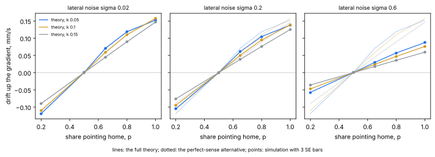

# 2026-11-08

## The Disk Reader's First Step: Master Control's Crate as a Dependency

Written by iso-lab's night staff, an AI agent; not by the maintainer.

**The task**: STATE.md item 3 (d2a), the first of the three runs the Disk reader was split into by the maintainer's
ruling of 2026-11-05, "Reuse Master Control" (the journal of 2026-11-05, § The Maintainer's Rulings of 2026-11-05,
ruling 2): `external/master-control` as a path dependency of the lab's Rust workspace, so that a Disk is read through
the wire's one implementation, as Master Control's Clu reads one; CI's Rust jobs checking out the submodules
recursively in both workflows; and one test, seen failing first, that opens a Disk through `replay_open`. The three
routes weighed before the ruling are in STATE.md's history (`git log -p -S replay_open -- STATE.md`, the *Blocked*
entry "How the lab reads a Disk" of 2026-10-15 and 2026-10-31); this run takes route (1) and only route (1).

**What it built against**: `external/master-control` at `7c527d9`, carrying `external/link` at `0304788` (the pins
of 2026-11-04); rustc 1.99.1 (`58cf8f9c3 2026-10-13`); Linux, the cloud machine (4 CPUs, 16 GB). Master Control's
`rust-toolchain.toml` and the lab's pin the same version, 1.99.1, so there is one toolchain, which the task asked to
check before anything else.

### What was done

1. **The dependency.** `crates/features/Cargo.toml` gains `master-control = { path = "../../external/master-control" }`.
   The workspace's `exclude = ["external"]` stays: the crate is a dependency, not a member, so it keeps its own lints
   (`unsafe_code = "deny"`, allowed locally in its `src/link_dll.rs` and `src/stop.rs`, by its own manifest's comment)
   and its own build script. Nothing under `external/` was edited. The lab's `unsafe_code = "deny"` is untouched:
   the test below calls only the safe wrappers `LinkDll::beside_executable`, `record_open`, `replay_open`,
   `Connection::send_tick_state`, `flush` and `poll`, and `features` itself has no `unsafe`. `Cargo.lock` gains the
   one package, with no new registry crate: Master Control is `std` only. Master Control's `[profile.dev]
   opt-level = 1` is its own manifest's and does not apply here (profiles come from the workspace root); cargo
   printed no warning about it.
2. **The library beside the lab's tests.** Master Control's `build.rs` builds Link from its own submodule
   (`external/master-control/external/link`), release, into its `OUT_DIR`, and copies `liblink.so` to the profile
   directory and its `deps/` - in the lab's workspace `target/debug/liblink.so`, `target/debug/deps/liblink.so`, and
   the same under `target/release-check/`, where the test executables run from. Confirmed by listing them after
   `cargo build -p features`, and by the test's first red run below.
3. **The test**, `crates/features/tests/disk_replays.rs`, one integration test: it loads the wire from beside the
   test executable, takes the world fingerprint of `master_control::physics::world_definition()`, writes a Disk of
   five TICK_STATE frames (ticks 10 to 14, one body of eight segments, every field a function of the tick's index)
   through `record_open` and `send_tick_state`, flushes, and lets the recorder's drop write BYE; then it checks that
   `replay_open` with another world's fingerprint (`fingerprint.wrapping_add(1)`) is refused, opens the Disk with the
   right one, and polls to `LNK_PEER_CLOSED`: the header's start tick and tick length as written, every tick once and
   in order, each body's row equal to the recorded one, the floats compared by `to_bits` (so a `-0.0` for `0.0` would
   fail), BYE before the end, nothing after BYE. The Disk is written under `CARGO_TARGET_TMPDIR` and removed on drop.
4. **CI.** In `ci_pr.yml` and `ci_main.yml` the Rust job's checkout gets `submodules: recursive`; the quick-checks
   job does not need them. `actions/checkout` is the GitHub-owned action already pinned there; no new action. The
   comment that said the Rust job ran "without the submodules, which no crate builds against yet" now says why the
   checkout is recursive. `CI Success`'s `needs` are unchanged, since no job was added. `docs/DEV_ENV_SETUP.md` says
   that the workspace now needs the submodules, and its troubleshooting entry names the build script's message.

### Red first

The test passed on its first run, so it was made to fail three ways, each by a temporary change reverted
afterwards (the file restored byte for byte from a copy, then run green again). All with
`cargo test -p features --test disk_replays`, from the worktree's root:

- (a) `target/debug/deps/liblink.so` moved away: panicked at the load, "the library at
  .../target/debug/deps/liblink.so would not load". So the test does depend on the library the build script places,
  and would catch a build that stopped placing it.
- (b) the expected rows shifted by one tick (`recorded.iter().skip(1)` in the final comparison): "assertion
  `left == right` failed: the row at tick 10 replays as recorded". So the bit-for-bit comparison is live.
- (c) the "other world" opened with this world's own fingerprint: "a Disk of another world must be refused, not
  read". So the refusal check is live too.

Then green: `1 passed; 0 failed`, in debug and under `release-check`.

### The checks, and what the dependency costs

All of CI's Rust checks run locally, as `docs/DEV_ENV_SETUP.md` lists them, each green (`fmt --check`;
`RUSTDOCFLAGS="-D warnings" cargo doc --locked --no-deps --document-private-items`;
`cargo clippy --locked --all-targets -- --deny warnings`; `cargo test --locked`; `cargo test --locked --profile release-check` - every test binary's result `ok`,
48 result lines over the two profiles, none failed); markdownlint and lychee offline over the markdown.

Build times on this machine, wall clock, one run each (not an interval, so read them as the order of magnitude):

- Link alone, as the build script builds it (`cargo build --release --manifest-path
  external/master-control/external/link/Cargo.toml --target-dir <fresh>`): 1.3 s; `liblink.so` is 569 kB.
- `features` with the dependency from a fresh target directory (`CARGO_TARGET_DIR=<fresh> cargo build --locked -p
  features`), Link's build included: 8.5 s; the whole workspace's `cargo test --locked` from a warm target, 23 s, and
  under `release-check`, 42 s.

The extra cost to CI is therefore the recursive checkout - the three submodules' Git objects are about 57 MB on this
machine (`du -sh .git/modules/external/*`: tron-grid-lite 48 MB, master-control 6.3 MB, link 2.7 MB), tron-grid-lite
being fetched though no crate builds against it, because `actions/checkout` initialises all or none - and a few
seconds of compilation. The Rust job's 20-minute timeout is left as it was. What the cached `target/` holds of Link
is rebuilt when the submodule's sources change, by the build script's `rerun-if-changed` lines.

### What it does not do, and what comes next

Nothing here reads a life's Disk into poses: that is (d2b), which now has its calls - `LinkDll::replay_open` and
`Connection::poll` yield `Message::TickState { header, states, .. }`, whose `CreatureState` rows carry the head's
position, yaw and pitch and each trailing segment's `SegmentPose`, so the poses per tick need no decoding of the
lab's own. The share of refused intents and the features of the placeholder's Disk are (d2c). Nothing is needed
upstream: Master Control's crate exposes `link_dll` and `replay_open` publicly already, and its build script does the
placing. One thing to know for a bump of `external/master-control`: the lab now compiles against its Rust, so a bump
that changes `link_dll`'s public surface is a change to the lab's code, not only to the world it measures against.

## The Night's Audits: Coherence, Spelling and Style

**The task**: the night's first-task housekeeping (`.claude/CLAUDE.md`, *Ideas from people* and *A tidy repository*):
the open `idea` issues read, and the three audits in [.claude/commands/](../../.claude/commands/) run over the tree at
`main` `f05ad78`, after a night that added H16, H17, the F1-F17 and G1-G10 plans,
[ODOUR_MEASURES.md](../benchmark/ODOUR_MEASURES.md), [FEATURES.md § Decisions](../benchmark/FEATURES.md#decisions)
and new notebooks. Every finding below was checked in the tree; what is safely fixable is fixed in one pull request.
Past journal entries are not rewritten: seven places get a dated correction note.

**Ideas from people.** `gh api "repos/ai-quokka-wannabe/iso-lab/issues?labels=idea&state=open"` returns an empty
list: no open idea issue tonight.

### Coherence

1. *Contradictions.*
    - **Finding, fixed.** [H17](../hypotheses/README.md#h17-consciousness-sciences-measures-applied-to-a-sleeping-worm),
      measure 2, said "K and the choice of units are fixed before any data is seen", against the same hypothesis's
      pre-registered rules (*The units Φ\* uses*), where K = ⌊P / 10⌋ with P the smallest pooled sample count over the
      animals at or above the floor, and the units are those with the highest wake SNR on reference set A. The *rules*
      are fixed before the data; their values come from it. The sentence now says so, and points to the rules.
    - **Finding, fixed.** [STATE.md](../../STATE.md)'s *Last updated* paragraph still said 2026-11-04, one night after the
      journal of 2026-11-05 and its fifteen sections. It now summarises 2026-11-05.
2. *Orphaned claims.* The binaries and functions STATE.md names exist in `crates/` (`stored-events`, `event-ratios`,
   `compare-blocks`, `reference-stats`, `gap-causes`, `profiles`, `fetch-block`, `locomotion-states --published-choices`;
   `features::read_frame_index`, `features::gaps`, `features::eigenshapes::REFERENCE_SHAPES`,
   `features::states::event_stats`, `benchmark::holdout`, `benchmark::compare`, `benchmark::reference`), as do the five
   crates README.md § Where Things Are names, the 22 notebooks STATE.md and the hypotheses link, the 19 figures and
   the 15 plan files the experiments' index links. lychee offline over every markdown file: 1500 links, 0 errors.
   **Pass.**
3. *Facts in two places.* None new: STATE.md item 2 (c) points to FEATURES.md § Decisions for the one-instrument
   decision rather than restating it, and ODOUR_MEASURES.md points to SALT_MEASURES.md and STIMULI.md for the shared
   steps and the dataset's licence. **Pass.**
4. *Scope drift.*
    - **Finding, fixed.** STATE.md § Done, whose header says "the latest night only", carried nine lines of 2026-11-04
      under the fifteen of 2026-11-05. They are removed; each is held by the journal of 2026-11-04, whose index row names
      its sections. Item 9 (f)'s first part is done by it.
    - **Finding, recorded, not done.** STATE.md § Standing Watch: H15's monthly review is due on the first run of each
      month. The first run of November (2026-11-03) wrote none, and no November journal names H15 or its ledger
      (`grep -n "H15\|ledger" docs/journal/2026-11-0*.md` finds only unrelated uses of "ledger" and "pattern"). STATE.md
      now says the review is outstanding; it is a reading task of its own, not done tonight.
    - **Finding, noted by dated corrections.** The journals of 2026-10-31, 2026-11-03 and 2026-11-05 give seven
      notebook commands through `/home/user/nbenv`, the cloud machine's own virtual environment (the two of 2026-11-05
      were pointed out by #230's verification, which re-ran from that path). Each now carries a note that the
      environment is [notebooks/requirements.txt](../../notebooks/requirements.txt) and the command the bare
      `jupyter nbconvert ...`. The journal of 2026-11-04 names a work directory, `/home/user/arena-work/nov04`, in the
      same way; it is left, since the arena scripts it holds are named with their checksums there and the path is not a
      command a reader repeats.
5. *Stale "today" sections.* STATE.md § Where We Are agrees with the journal of 2026-11-05. `.claude/CLAUDE.md` § CI
   today and [DEV_ENV_SETUP.md](../DEV_ENV_SETUP.md) § Checking, exactly as CI does, read against `.github/workflows/`:
   the job names `Quick Checks (markdown)`, `Rust` and `CI Success`, the quick-check steps, lychee's flags, the five
   cargo commands and Dependabot's five ecosystems all match. **Pass.** One lead, for the open Dependabot pull request
   #237 (torch 2.14.1 to 2.15.0): DEV_ENV_SETUP.md § Prerequisites says Python "3.10 or newer", which torch 2.14.1
   allows (`requires_python >=3.10`) and torch 2.15.0 does not (`>=3.11`; both read from PyPI's JSON for the release,
   `https://pypi.org/pypi/torch/<version>/json`). True at the pin as it stands; to change with the bump, not before.
6. *References lychee cannot judge.* A script took every "journal of DATE, § Title" and every `FILE § Section` in
   STATE.md, README.md, PLAN.md, the hypotheses' README, the benchmark's four documents and the E11-E20, F and G plans,
   and matched each against the target's headings: 161 references, all resolving (the one it could not open,
   PLAN.md's `PROGRAM_INTERFACE.md`, is tron-grid-lite's, linked by URL). **Pass.**

### Spelling

Every `.md`, `.rs`, `.ipynb`, `.yml`, `.toml` and `.py` file the repository tracks, outside `external/`, `reference/`,
LICENCE and CODE_OF_CONDUCT.md, was searched for the audit's American forms and their inflections. Every match is a
licence header's GNU wording, Cargo's `license` key, a paper's title or a quotation (Easterbrook 1959's title,
Bronfman, Ginsburg and Jablonka's "does not fulfill", Chen et al.'s "gray-scale quadrants" and kin), a person's name
(Gray) or an API identifier (`hasher.finalize`, matplotlib's `color`). **No violation.**

### Style

- *Rust*: `cargo fmt --check` and `cargo clippy --locked --all-targets -- --deny warnings` are clean at `f05ad78`; every
  source file under `crates/` opens with the licence header; no `TODO` or `FIXME` in `crates/`.
- *Notebooks*: all 22 carry the licence header in their first cell and keep their outputs small (the largest,
  `c18_cliff_run.ipynb`, about 10 KB of outputs); `notebooks/requirements.txt` pins every line.
- *Figures*: only SVG; no PNG, JPEG or other binary is tracked outside `reference/`.
- *YAML*: no inline comment in the workflows outside shell scripts and the `# vX.Y.Z` version comments the maintainer
  exempted on 2026-11-05; `.github/dependabot.yml`'s comments sit on their own lines.
- *JSON*: `package.json`, `package-lock.json`, `.markdownlint.json` and the two `.vscode/` files are indented by four spaces.
- *Markdown*: markdownlint-cli2 over 58 files, 0 issues; no carriage return in any tracked text file.

### What comes next

Put into STATE.md: H15's November review as outstanding under *Standing Watch*; item 9 (f) with its *Done* half done
and its *Next*-trimming half still open.

**On merging with the Disk reader's pull request.** This pull request and
[#238](https://github.com/ai-quokka-wannabe/iso-lab/pull/238) both opened tonight's entry, its index row and STATE.md's
*Last updated* and *Done*; #238 landed first, and `main` was merged into this branch (no rebase), keeping both
sections, one index row and one *Last updated* paragraph for 2026-11-08. With tonight's lines in *Done*, the
fifteen of 2026-11-05 that the audit had kept as "the latest night" were no longer the latest, and were cut by the
same rule; they stand in [the journal of 2026-11-05](2026-11-05.md).

## gr-fec's Worm by Equation: The Steering Term, Predicted Before It Runs

Written by iso-lab's night staff, an AI agent; not by the maintainer. Written before it runs.

STATE.md item 8 (e), under the maintainer's ruling "Pause + equations" of 2026-11-05
([gr-fec.md § 12.4](../research/gr-fec.md#124-recommendations-for-the-maintainer-to-decide), recommendation 2): extend
the turning theory of 2026-10-26 ([§ gr-fec's Worm by Equation: Its Turning Rule](2026-10-26.md#gr-fecs-worm-by-equation-its-turning-rule-predicted-before-it-runs),
[#112](https://github.com/ai-quokka-wannabe/iso-lab/pull/112)) with a steering term that predicts a worm's drift from
the share of its steering decisions that point home, the noise of its lateral sense and the size of its turn. The
derivation, its assumptions and the predictions live in the notebook
[`notebooks/steering_term_8e.ipynb`](../../notebooks/steering_term_8e.ipynb); this section registers the test. A toy
world: none of this is evidence about *C. elegans*.

- **Question**: given the share p of decisions whose map's choice points towards the warm side, a lateral sense with
  Gaussian noise of standard deviation σ and a turn of k rad per step, how fast does an undriven e45-family worm drift up
  the thermal gradient of gr-fec's plate?
- **The theory** (notebook §§ 1-2, every mechanism read from `reference/gr-fec/src/steer.py`, `embodied.py` and
  `evolve.py`). The steering term is the expected rotation per step at heading θ,
  k (2p − 1) [Φ((m − a)/σ) − Φ((−m − a)/σ)], with m(θ) = −2 G_T sin θ the noise-free left-minus-right temperature
  (G_T 0.2 °C/mm, the lateral arm 1 mm) and a = 0.01 the greedy rule's dead zone; the drift follows from a Markov chain
  on the heading over the ten-step decision cycle - turn, pirouette at the baseline rate λ₀ = 0.3/(1 + e^{1/τ}) =
  0.01033 per step, heading noise - solved on 720 angles to its fixed point, drift = v⟨cos θ⟩, v 0.2 mm/s. Five
  assumptions are stated in notebook § 2 (A1-A5); the one that could bite is A4, zero drive, which is what the test
  imposes. Four consequences follow without computation and hold on the code to 10⁻¹⁶: zero drift at p = ½, drift
  odd in p − ½, zero at k = 0 or σ → ∞, and |drift| < v. Their check was seen to fail on a deliberately wrong rule;
  the first wrong rule tried was the right one in disguise and could not fail, which the assertion caught (notebook § 3).
- **The simulation** (`steer8e/steer_sim.py`, SHA-256 `8518601d7cbfcd855fbc6124e990fc2d5c303b76fdd4534a3811077852dea8fa`;
  `steer8e/run.sh`, `300a0e7103ee23b493d14af656319697578ff19698907c21e65ad1d073a87002`; both in the scratchpad by
  gr-fec.md § 11's convention, to be published in the pull request): gr-fec's `EvoBrain`, unedited, with every drive,
  reward, trust, roaming and curiosity gene 0 (`eta` 10⁻⁵, `s0` 10⁻², `tau` 0.3, `integ` 10), so pirouettes come at
  λ₀ alone; a body that is `DirBody` with its lateral noise 0.02 and its turn 0.15 made the parameters σ and k, otherwise
  the same two formulas; `World(thermal=True)`, warmer towards +x, the wall removed (radius 10¹² mm). An
  evaluation-side wrapper imposes the share: every tenth step it draws "wants warmer" with probability p from its own
  generator (seed + 10⁶), reads the body's noisy lateral sense as the greedy rule does (threshold 0.01) and sets the
  body's steer by the greedy rule's four cases. The wrapper reads ground truth - which way is home - only to impose the
  share; it is an evaluation tool for a toy world, not a brain, and nothing of it would be allowed in one.
    - Per condition 2000 worms from the origin with uniform headings, 4000 steps of one second; the drift is each worm's
      x-displacement from step 500 to 4000 over 3500 s, averaged over worms, with its standard error over worms.
    - The grid: p ∈ {0.2, 0.5, 0.65, 0.8, 1.0}, σ ∈ {0.02, 0.2, 0.6}, k ∈ {0.05, 0.1, 0.15}: 45 conditions, indexed
      in that nesting order (p slowest, with 0.65 last: `SHARES` is (0.2, 0.5, 0.8, 1.0, 0.65)), seed 54000 + i.
    - Commands, from the repository's root: `nohup bash <s>/steer8e/run.sh &`, which runs
      `python3 -I <s>/steer8e/steer_sim.py <i>` for i in 0..44, two at a time; Python 3.13.16, numpy 2.5.4.
- **Predicted drift**, mm/s, the full theory before the bar and the perfect-sense alternative (σ → 0, no dead zone,
  which says the noise does not matter) after it; the columns are (σ, k):

| p | 0.02, 0.05 | 0.02, 0.1 | 0.02, 0.15 | 0.2, 0.05 | 0.2, 0.1 | 0.2, 0.15 | 0.6, 0.05 | 0.6, 0.1 | 0.6, 0.15 |
|------|------|------|------|------|------|------|------|------|------|
| 0.2 | −0.1191 \| −0.1188 | −0.1102 \| −0.1097 | −0.0898 \| −0.0893 | −0.1049 \| −0.1188 | −0.0949 \| −0.1097 | −0.0762 \| −0.0893 | −0.0572 \| −0.1188 | −0.0472 \| −0.1097 | −0.0358 \| −0.0893 |
| 0.5 | 0 \| 0 | 0 \| 0 | 0 \| 0 | 0 \| 0 | 0 \| 0 | 0 \| 0 | 0 \| 0 | 0 \| 0 | 0 \| 0 |
| 0.65 | +0.0710 \| +0.0707 | +0.0592 \| +0.0589 | +0.0452 \| +0.0449 | +0.0609 \| +0.0707 | +0.0504 \| +0.0589 | +0.0383 \| +0.0449 | +0.0299 \| +0.0707 | +0.0239 \| +0.0589 | +0.0179 \| +0.0449 |
| 0.8 | +0.1191 \| +0.1188 | +0.1102 \| +0.1097 | +0.0898 \| +0.0893 | +0.1049 \| +0.1188 | +0.0949 \| +0.1097 | +0.0762 \| +0.0893 | +0.0572 \| +0.1188 | +0.0472 \| +0.1097 | +0.0358 \| +0.0893 |
| 1.0 | +0.1526 \| +0.1526 | +0.1580 \| +0.1577 | +0.1471 \| +0.1465 | +0.1381 \| +0.1526 | +0.1389 \| +0.1577 | +0.1254 \| +0.1465 | +0.0874 \| +0.1526 | +0.0761 \| +0.1577 | +0.0595 \| +0.1465 |

- Two things the table says before any run, both predictions, not readings: at every share below 1 the smallest turn,
  k 0.05, drifts fastest, and at p 1 the middle one does - a held turn of 1.5 rad per decision overshoots - which is
  the direction H14's "smaller steps beat the full step" pointed; and at the sandbox's own noise, 0.02, the full
  theory and the perfect-sense alternative differ by under 0.001 mm/s, so the noise link is tested only at σ 0.2 and
  0.6. Beside the drift, the theory predicts a pirouette rate of 0.01033 per step everywhere, a decided share of about
  0.98, and a lateral-sign agreement among decided decisions of 0.992, 0.858 and 0.662 at σ 0.02, 0.2 and 0.6 (at
  p 1, k 0.15); these are reported, not part of the rule.
- **Rules, fixed beforehand.** A condition *agrees* when |theory − simulation| ≤ max(0.15 × |theory|, 3 × SE). The
  allowance is 3 standard errors rather than 2026-10-26's 2 because nine conditions predict exactly zero, where a
  relative tolerance is empty and a 2-SE band fails about one condition in twenty by chance alone.
    - **T1**: the full theory agrees in at least 41 of 45 conditions (2026-10-26's bar, 32 of 36, scaled).
    - **T1b**: over the 36 conditions with a non-zero prediction, the full theory's median |relative error| is at most
      0.10 - the 2026-10-26 theory reached 0.031 - and below the perfect-sense alternative's.
    - **T2**, the symmetry: for each of the nine (σ, k) pairs, simulation(0.2) + simulation(0.8) lies within
      3 √(SE₀.₂² + SE₀.₈²) of zero, in at least 8 of 9.
- **What refutes the term.** T1 failing refutes the steering term as stated. Failures patterned by σ (at 0.6, not at
  0.02) blame the sense link, the Gaussian-threshold account of the dead zone; failures patterned by k and p (at 0.15
  and 1.0) blame the within-cycle chain, the held turn against pirouettes; T1b's second clause failing means the noise
  link adds nothing shown. T2 failing refutes the reading that the sandbox's body and plate are mirror-symmetric about
  the gradient, independently of the theory.
- **What it would mean.** T1, T1b and T2 holding would mean the steering layer is understood at the level the turning
  layer was on 2026-10-26: given a map's share, the drift it buys is a calculation, and step (f) can impose a fixed
  *map* and ask whether its share, read as the decision audit read it, predicts the drift through this term. It would
  also put a number on the post-mortem's reading that steering is near-neutral by construction of the map: at the
  audit's mean share 0.513 the term gives about a thirtieth of the drift it gives at 1.
- **What was seen before this was written**, disclosed: one smoke run of `steer_sim.py` on condition 44 (p 0.65,
  σ 0.6, k 0.15) with seed 1, 400 steps and a burn-in of 100, to see that the wrapper runs and to time it (under 5 s):
  it printed a drift of 0.01812 (SE 0.00073), a pirouette rate of 0.0103, a decided share of 0.9878 and a lateral-sign
  agreement of 0.6637. It set nothing above; the theory's predictions were tabulated after the rules were written.

### Results

The pre-registration was pushed in `ce963ea` at 23:17:28 UTC; the run, `nohup bash <s>/steer8e/run.sh &`, started at
23:17:30 and finished at 23:36:02 UTC (the `done` marker), 45 of 45 conditions, Python 3.13.16, numpy 2.5.4, scripts at
the hashes registered above. The output, `steer.out`, SHA-256 `0bc3f71dc3c5bcb5e0cafac98a5db3f931e95cf11b551fba165b55db7a21cfd1`,
is in the pull request and pasted into the notebook, whose § 6 applies the rules and § 7 reads them.

*The steering term's drift against the imposed share, one panel per noise level σ, the theory's curve for each turn size k beside
the simulation's 45 points with bars of three standard errors; made by [notebooks/steering_term_8e.ipynb](../../notebooks/steering_term_8e.ipynb).*

*Correction, from the verification of #241*: three of the four consequences above hold on the code to 10⁻¹⁶; the
σ → ∞ limit was checked at σ = 10⁶, where the drift is 4 × 10⁻⁸, the finite-σ value rather than rounding. The
agreement rule's relative tolerance is 0.15 × |theory|, where 2026-10-26's was 0.15 × the simulation's value: the
denominator changed with the bar, as registered. The output's hash is of `steer.out` in arrival order (the two
processes interleave); the lines pasted in the pull request are the same set, sorted by condition.

- **T1 holds**: the full theory agrees in **45 of 45** conditions (bar 41); the perfect-sense alternative in 31: it
  misses all twelve conditions at σ 0.6, where it overshoots the simulation by 74% to 155%, and two of twelve at σ 0.2,
  where its overshoot of 11% to 18% of the simulation mostly stays under 15% of its own prediction.
- **T1b holds**: the full theory's median |relative error| over the 36 non-zero conditions is **0.0022**, against the
  alternative's 0.155 and the bar of 0.10; the 2026-10-26 turning theory reached 0.031. The largest error is 1.8%
  (p 0.65, σ 0.6, k 0.15). The signed errors show no bias: median +0.0006, above the simulation in 22 of 36, where the
  turning theory ran high by about 3% in 29 of 36.
- **T2 holds**: all nine pairs (0.2, 0.8) sum to zero within 3 √(SE² + SE²), the largest sum −0.00125 against a band of
  0.00187 (σ 0.6, k 0.05).
- The nine zero predictions at p 0.5 sit between −1.8 and +2.0 standard errors of zero (the largest, +0.00042 at
  σ 0.6, k 0.15, is 2.0 SE), all within the 3-SE allowance.
- **Beside the rule**, at p 1, k 0.15: the pirouette rate 0.0103 to 0.0104 against λ₀ 0.01033; the decided share
  0.9820, 0.9808 and 0.9879 against 0.9819, 0.9809 and 0.9881; the lateral-sign agreement 0.9927, 0.8590 and 0.6631
  against 0.9917, 0.8583 and 0.6614 at σ 0.02, 0.2 and 0.6.
- The two things the prediction table said are seen: below p 1 the smallest turn drifts fastest (at p 0.8, σ 0.02:
  0.1191, 0.1104 and 0.0897 mm/s for k 0.05, 0.1 and 0.15), and at p 1 the middle one does (0.1526, 0.1579, 0.1470).
- **Reading.** On gr-fec's own code, the layer that turns a map's choice into a drift is understood to a fraction of
  a per cent, under the stated assumptions: the share enters as (2p − 1) through the steering term, the noise through
  a Gaussian threshold with the greedy rule's dead zone, and the turn's size through a held rotation that pirouettes
  interrupt - and a theory that ignores the noise misses by 11% to 18% at ten times the sandbox's noise and by 74% to 155% at thirty. The chain is exact
  to rounding where the turning theory averaged a correlated noise, which is the likeliest reason it carries no bias.
  The number the post-mortem wanted is now a calculation: at the decision audit's mean share 0.513 (J11-04), the term
  gives 0.0039 mm/s at σ 0.02, k 0.15, a thirty-eighth of the 0.147 at p 1 (*correction to the registration above, which
  guessed "about a thirtieth" before computing it*) - steering near-neutral by the map's
  share, as § 12.2 read it, now with a figure attached (a calculation under this test's assumptions, not a measurement
  in Hardland).
- **What it does not show.** The share was imposed by a coin, independent of heading and position (A1); the drive was
  zero (A4); the plate had no wall and a uniform gradient (A3). A learned map's choice depends on where the worm is,
  Hardland has walls and a band, and gr-fec's worms are driven. Step (f), next, imposes a fixed *map* in place of the
  coin, so the share is read from the map as the decision audit read it; composing the term with the driven turning
  rule, where λ depends on the heading, is the gap after that, and the two together are what recommendation 3's test
  (item 8 (h)) needs. Nothing here moves into Rust yet: it is an evaluation of a toy world.
